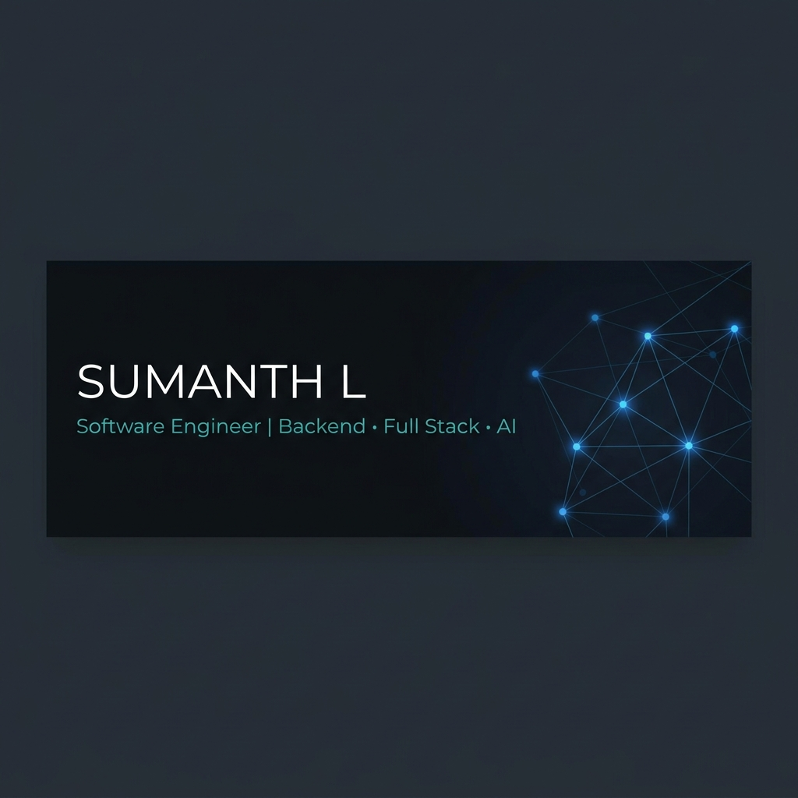

  

# Hi, I'm Sumanth L 👋
I am a Computer Science undergraduate passionate about building high-performance systems and scalable web applications. My expertise lies in **Backend Engineering**, **Full-Stack Development**, and **AI Engineering**. I enjoy implementing core algorithms from scratch and bridging the gap between local AI capabilities and modern web interfaces.
- 🎓 **Undergraduate** in Computer Science & Engineering
- 🚀 **Full-Stack & Backend** developer specializing in robust, production-ready system architectures
- 🤖 **AI Developer** building local RAG pipelines and high-performance indexing systems
- 💬 Ask me about: **C++, JavaScript/TypeScript, Next.js, and Data Structures & Algorithms**
---
## 🛠️ Tech Stack & Skills
### 💻 Languages

### 🌐 Frontend & Web Technologies

### ⚙️ Backend & Database

### 🤖 AI Engineering & Tools

---
## 🏆 Featured Projects
### 🧠 [VectorDB AI Assistant](https://github.com/Sumanth0718/vectordb-ai-assistant)
A high-performance C++ vector database built from scratch, featuring Hierarchical Navigable Small World (HNSW) graphs, space-partitioning KD-Tree, and exhaustive brute force search. Includes a custom REST API and a live 2D PCA projection dashboard alongside a local Retrieval-Augmented Generation (RAG) pipeline powered by Ollama.
* **Tech Stack:** C++17, Ollama, Llama 3.2, `nomic-embed-text`, `cpp-httplib`, HTML5, CSS3, JavaScript
### 🏃‍♂️ [Athlete Sponsorship Management Platform](https://github.com/Sumanth0718/athlete-sponsorship-platform)
A secure full-stack platform for professional athletes and brand managers to track deals, manage brand directories, analyze legal agreements, and automatically generate invoice/payment reminders.
* **Tech Stack:** Next.js 15 (App Router), React 19, Tailwind CSS, PostgreSQL, Prisma ORM, Auth.js (NextAuth v5), OpenAI GPT-4o-mini, Cloudinary
### 🎓 [Student Placement Tracker](https://github.com/Sumanth0718/Student-placement-tracker)
A modular and highly secure student placement tracking dashboard implementing JWT stateless sessions, database route guards, and data isolation boundaries to log interview runs, packages, and statuses.
* **Tech Stack:** React, TypeScript, Tailwind CSS v4, Node.js, Express.js, MongoDB (Mongoose), MongoMemoryServer (Fallback)
---
## 📈 Stats & Activity

  
  

<!--
**Sumanth0718/Sumanth0718** is a ✨ _special_ ✨ repository because its `README.md` (this file) appears on your GitHub profile.

Here are some ideas to get you started:

- 🔭 I’m currently working on ...
- 🌱 I’m currently learning ...
- 👯 I’m looking to collaborate on ...
- 🤔 I’m looking for help with ...
- 💬 Ask me about ...
- 📫 How to reach me: ...
- 😄 Pronouns: ...
- ⚡ Fun fact: ...
-->
